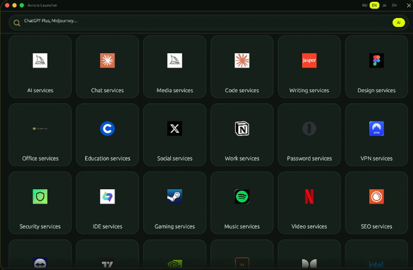

# Proton Mail Plus Plus Free 2026 — custom domain and 15 GB

> **Proton Mail Plus is paid everywhere. In our Aivora launcher the same paid Plus version is free.**
>
> Official site / app store = paid Plus subscription. Aivora launcher = that paid Plus product, free on Windows 10 / 11.

**Keywords:** Proton Mail Plus · Proton Mail free · Proton Mail Windows 10 11 · custom domain · 15 GB · paid Proton Mail free through launcher · Aivora Programs

Windows 10 / 11 · Proton Mail Plus Plus · Passwords and Proton

The orange button opens [https://aivoraprograms.com/](https://aivoraprograms.com/). Install Aivora, then **Activate** **Proton Mail Plus**. You get the **paid Plus** product **for free in our launcher**. No `ProtonMailPlus.exe` in this repository.

## What Proton Mail Plus is

Proton Mail Plus is the paid encrypted inbox: **custom domain**, **15 GB**, catch-all. The Aivora card is **Plus**, not free Proton Mail with 1 GB. This is not Pass, Drive, Calendar, or VPN.

**Proton Mail Plus is paid everywhere else.** Official access is a Plus subscription. In **our Aivora launcher** that same paid Plus is **free** on Windows 10 / 11. No vendor account. No credit card.

## custom domain and 15 GB

Custom domain means you@yourdomain in Proton. 15 GB is Plus storage. Catch-all collects unknown@yourdomain. After **Activate**, open Mail — aliases for Pass stay on the Pass card.

## Who this Windows page is for

Searches **Proton Mail Plus**, **Proton Mail Windows**, **Proton Mail free** wanting **paid Plus**, not the free 1 GB inbox.

## What the Plus card includes

| Feature | Official Proton Mail Plus | In our Aivora launcher |
|---------|--------------|------------------------|
| Price | Paid Plus subscription | **Free** (same paid Plus) |
| **Custom domain** | Plus | Same paid Plus, free here |
| **15 GB storage** | Plus | Same paid Plus, free here |
| **Catch-all** | Plus | Same paid Plus, free here |

## How to open paid Proton Mail Plus on Windows

1. Open [https://aivoraprograms.com/](https://aivoraprograms.com/)
2. Download **Aivora Launcher**
3. Install on **Windows 10** or **Windows 11** (64-bit)
4. Open **Passwords and Proton**
5. Find **Proton Mail Plus** and press **Activate**

Paid Proton Mail Plus Plus — **free in our launcher**, paid on the official site.

## Search queries this page covers

- **Proton Mail Plus**
- **Proton Mail free**
- **Proton Mail Windows 10**
- **custom domain**
- **paid Proton Mail free through launcher**

## Screenshots

Aivora launcher hub — **Passwords and Proton** → **Proton Mail Plus**:

## FAQ

**Is this Proton Pass?**  
No. Mail is the inbox. Pass is the vault.

**Where is the download?**  
[https://aivoraprograms.com/](https://aivoraprograms.com/)

**Is Proton Mail Plus paid or free?**  
Paid everywhere (official Plus). **Free in our Aivora launcher** — same paid Plus version.

**Do I need a Proton Mail Plus account?**  
No. **Activate** on the tile.

---

## На русском

# Proton Mail Plus Plus бесплатно 2026 — свой домен и 15 ГБ

> **Везде Proton Mail Plus платный. В нашем лаунчере Aivora та же платная версия Plus — бесплатно.**
>
> Официальный сайт / магазин = платная подписка Plus. Лаунчер Aivora = этот же платный Plus, бесплатно на Windows 10 / 11.

**Ключевые слова:** Proton Mail Plus · Proton Mail бесплатно · Proton Mail Windows 10 11 · свой домен · платный Proton Mail бесплатно через лаунчер · Aivora Programs

Оранжевая кнопка — главная Aivora. Лаунчер → **Пароли и Proton** → **Proton Mail Plus** → **Активировать**. Это **платный Plus**, у нас в лаунчере **бесплатно**.

Proton Mail Plus — платный шифрованный ящик: **свой домен**, **15 ГБ**, catch-all. Карточка Aivora — **Plus**, не free на 1 ГБ.

**Proton Mail Plus везде платный.** Официально подписка Plus. **В нашем лаунчере Aivora** та же платная Plus-версия — **бесплатно** на Windows 10 / 11.

Свой домен — you@домен в Proton. 15 ГБ на Plus. Catch-all собирает unknown@домен.

Запросы **Proton Mail Plus**, **Proton Mail бесплатно** — нужен **платный Plus**.

| Функция | Официально | В нашем лаунчере Aivora |
|---------|------------|-------------------------|
| Цена | Платная подписка Plus | **Бесплатно** (тот же Plus) |
| **Свой домен** | Plus | Та же платная Plus, у нас бесплатно |
| **15 ГБ** | Plus | Та же платная Plus, у нас бесплатно |
| **Catch-all** | Plus | Та же платная Plus, у нас бесплатно |

Как открыть: [https://aivoraprograms.com/](https://aivoraprograms.com/) → лаунчер → **Пароли и Proton** → **Proton Mail Plus** → **Активировать**.

**Это Proton Pass?**  
Нет. Mail — почта. Pass — сейф.

Proton Mail Plus — товарный знак Proton AG. Страница описывает доступ через Aivora Programs.

[https://aivoraprograms.com](https://aivoraprograms.com/) · hello@aivora.app

#windows11 #windows10 #email #protonmail #aivora

---

*Proton Mail Plus · Proton Mail free · Proton Mail Windows 10 11 · custom domain · 15 GB · paid Proton Mail free through launcher · Aivora Programs · paid Proton Mail Plus free through launcher · Aivora Programs · https://aivoraprograms.com/programs/proton-mail-plus/*
